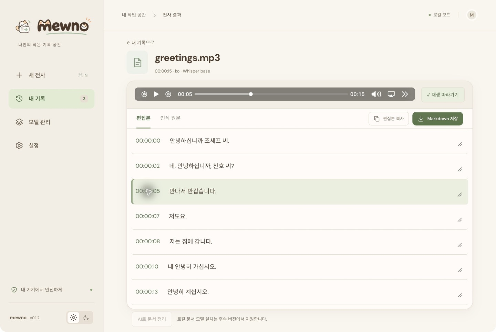
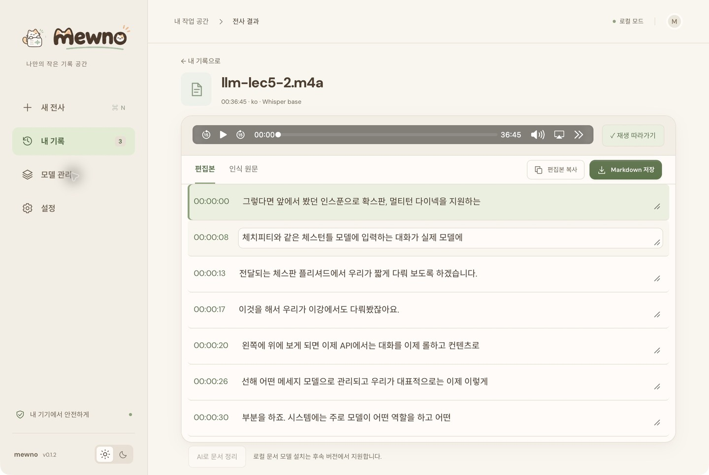

# Mewno

**강의나 회의를 다시 들을 때, 필요한 문장부터.** Mewno는 녹음과 영상 속 음성을 Mac에서 전사하는 앱입니다. 재생 중인 문장을 따라 읽고, 시간표시를 눌러 원하는 대목을 다시 들으며 전사문을 다듬을 수 있습니다.

[macOS 설치 파일 받기](https://github.com/makerjy/mewno/releases/tag/v0.1.2) · [지원 형식과 실제 시험 결과](docs/TEST_REPORT.md)

## 첫 전사 시작하기

1. **Apple Silicon Mac**에서 릴리스의 `Mewno-0.1.2-macOS-arm64.dmg`를 열고 **Mewno.app**을 **응용 프로그램**으로 옮깁니다.
2. **모델 관리**에서 **Whisper Base**를 다운로드합니다. 처음 모델을 받을 때 인터넷이 필요합니다. 다운로드 후 전사와 편집은 오프라인에서 할 수 있습니다.
3. **새 전사**에 MP3, M4A, WAV 또는 MP4 파일을 넣고 **전사 시작**을 누릅니다. 여러 파일을 넣으면 순서대로 처리합니다.
4. **내 기록 → 결과 열기**에서 원본을 들으며 전사문을 편집합니다. **편집본 복사**로 텍스트를 가져가거나 **Markdown 저장**으로 타임스탬프가 포함된 파일을 내보냅니다.

프리뷰의 최소 버전은 macOS 14로 설정되어 있으며, Apple Silicon 실기기에서 확인했습니다. 설치 이미지는 ad-hoc 서명 상태이며 Apple 공증 전이라 다운로드한 앱 실행이 Gatekeeper에서 제한될 수 있습니다. 소스 빌드 방법도 제공됩니다. [빌드 및 설치 문서](docs/BUILD_AND_RELEASE.md)

## 녹음에 맞춰 사용하기

- **긴 녹음 다시 듣기.** 재생바는 화면 위에 머물고, 전사문은 현재 문장을 따라 스크롤됩니다. 직접 스크롤하거나 편집한 뒤에는 **재생 따라가기**를 눌러 현재 위치로 돌아올 수 있습니다.
- **녹음에 맞는 모델 고르기.** Tiny는 빠른 확인, Base는 속도와 정확도의 균형, Small은 정확도를 우선할 때 쓰는 모델입니다.
- **한영 혼합 녹음.** Base로 한국어와 영어가 차례로 나오는 공개 음원을 전사해 두 언어가 각각의 문자로 기록되는 것을 확인했습니다. 한 문장 안에서 언어가 자주 바뀌면 전문 용어 철자를 원본과 대조하는 편이 좋습니다.
- **파일은 이 Mac에.** 음성 분석과 전사문 저장은 기기에서 이뤄집니다. 계정 없이 사용할 수 있습니다. [데이터 처리 방식](docs/PRIVACY.md)

다크 모드에서 모델 관리 화면 보기

## 개발 및 기여

Tauri, React, Rust, SQLite, whisper.cpp를 사용합니다. 다른 코덱에서 재현되는 문제를 제보할 때는 OS 버전과 파일 형식을 남겨 주세요. 개인 녹음 없이 재현할 수 있는 샘플이 있으면 함께 첨부할 수 있습니다.

[소스 빌드](docs/BUILD_AND_RELEASE.md) · [구조](docs/ARCHITECTURE.md) · [기여 방법](CONTRIBUTING.md) · [MIT 코드 라이선스](LICENSE) · [외부 구성과 브랜드 고지](THIRD_PARTY_NOTICES.md)

화면 예시에는 HappyMidnight의 공개 한국어 대화를 사용했습니다. [샘플 출처 및 CC BY-SA 4.0 고지](tests/fixtures/README.md)
